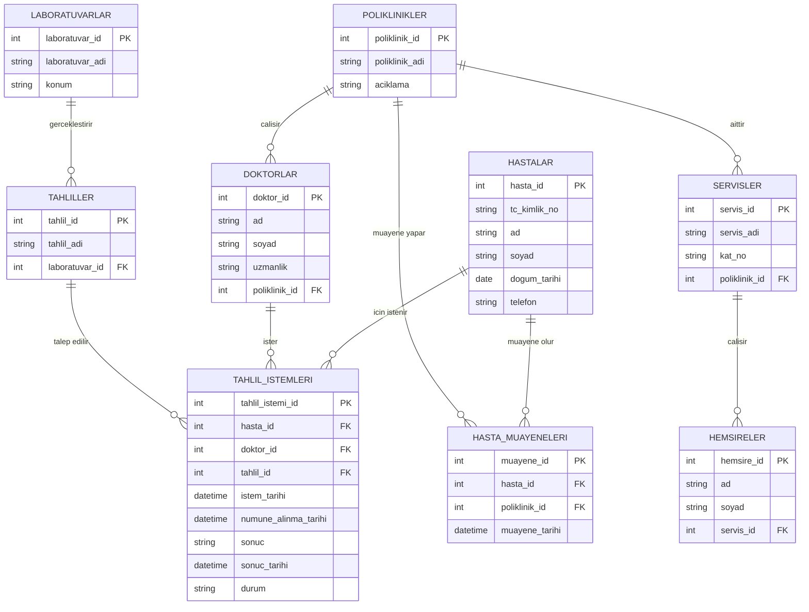

# Hastane Otomasyonu – ER Diyagramı

Bu diyagram, ödevde verilen yedi temel varlığı ve ilişkileri gösterir. Hasta–Tahlil ve Doktor–Tahlil N:M ilişkileri, hangi doktorun hangi hasta için hangi tahlili istediğini de saklayan `TAHLIL_ISTEMLERI` işlem tablosu üzerinden çözülmüştür.

## İlişki özeti

| İlişki | Tür | Uygulama |
|---|---|---|
| Poliklinik–Doktor | 1:N | `doktorlar.poliklinik_id` |
| Hasta–Poliklinik | N:M | `hasta_muayeneleri` |
| Hasta–Tahlil | N:M | `tahlil_istemleri` üzerinden |
| Doktor–Tahlil | N:M | `tahlil_istemleri` üzerinden |
| Laboratuvar–Tahlil | 1:N | `tahliller.laboratuvar_id` |
| Servis–Hemşire | 1:N | `hemsireler.servis_id` |
| Poliklinik–Servis | 1:N | `servisler.poliklinik_id` |

## Tahlil ilişkisinin nasıl çalıştığı

- `tahlil_istemleri.hasta_id`, tahlilin hangi hasta için istendiğini belirtir.
- `tahlil_istemleri.doktor_id`, tahlili isteyen doktoru belirtir.
- `tahlil_istemleri.tahlil_id`, istenen tahlil türünü belirtir.
- `sonuc`, `sonuc_tarihi`, `numune_alinma_tarihi` ve `durum` alanları sürecin ve sonucun izlenmesini sağlar.
- Aynı hasta aynı tahlili farklı tarihlerde yeniden yaptırabilir; her istek ayrı bir `tahlil_istemi_id` kaydıdır.
- Bir doktor farklı hastalara ve farklı tahlillere istek oluşturabilir. Her istek yalnızca bir hastaya, bir doktora ve bir tahlil türüne bağlanır.

## Diğer tasarım notları

- Bir doktor yalnızca bir polikliniğe bağlıdır; bir poliklinikte birden fazla doktor olabilir.
- Her tahlil türü tek bir laboratuvara bağlıdır.
- Her hemşire tek bir servise bağlıdır.
- Her servis tek bir polikliniğe bağlıdır.
- Aynı hasta farklı tarihlerde aynı poliklinikte yeniden muayene olabileceği için muayene tablosunda ayrı bir `muayene_id` kullanılmıştır.
