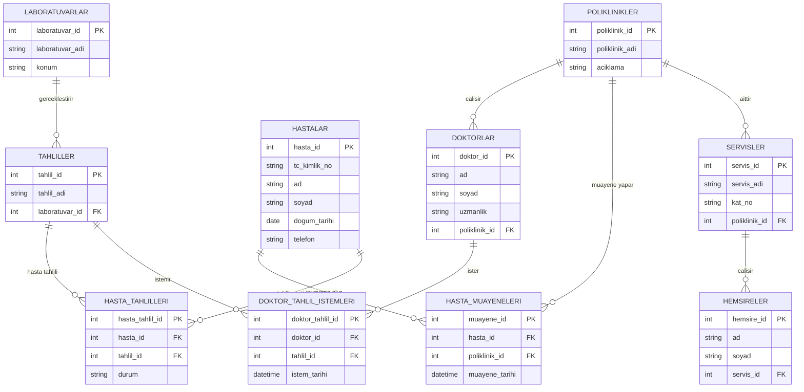

# Hastane Otomasyonu – ER Diyagramı

Aşağıdaki diyagram, ödevde verilen yedi varlığı ve ilişkileri gösterir. N:M ilişkiler ilişkisel tablolar tasarlanırken ara tablolarla çözülür.

## İlişki özeti

| İlişki | Tür | Uygulama |
|---|---|---|
| Poliklinik–Doktor | 1:N | `doktorlar.poliklinik_id` |
| Hasta–Poliklinik | N:M | `hasta_muayeneleri` |
| Hasta–Tahlil | N:M | `hasta_tahlilleri` |
| Doktor–Tahlil | N:M | `doktor_tahlil_istemleri` |
| Laboratuvar–Tahlil | 1:N | `tahliller.laboratuvar_id` |
| Servis–Hemşire | 1:N | `hemsireler.servis_id` |
| Poliklinik–Servis | 1:N | `servisler.poliklinik_id` |

## Önemli tasarım notu

- Bir doktor yalnızca bir polikliniğe bağlıdır; bir poliklinikte birden fazla doktor olabilir.
- Her tahlil tek bir laboratuvara bağlıdır.
- Her hemşire tek bir servise bağlıdır.
- Her servis tek bir polikliniğe bağlıdır.
- Aynı hasta farklı tarihlerde aynı poliklinikte yeniden muayene olabileceği için muayene tablosunda ayrı bir `muayene_id` kullanılmıştır.
- Doktorun istediği tahlil ile hastanın yaptırdığı tahlil ayrı ilişki tablolarında tutulmuştur. Gerçek bir sistemde bu iki ilişki, ayrıca bir tahlil istemi/işlem kaydı üzerinden ilişkilendirilebilir.
